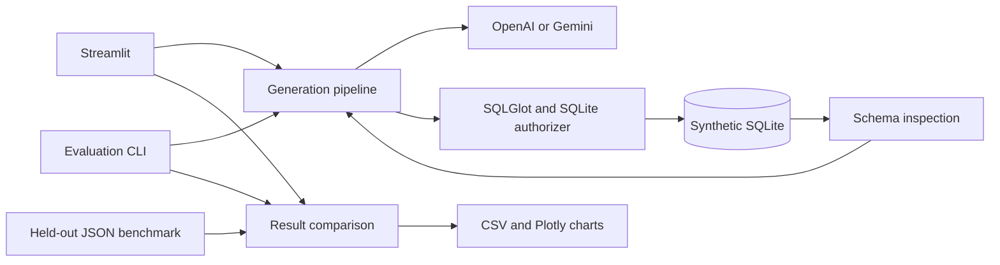
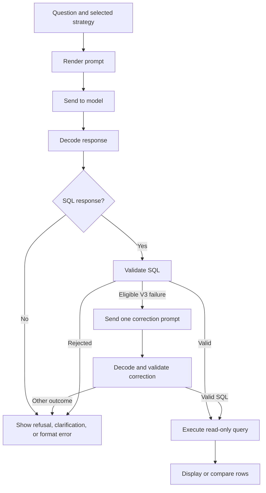
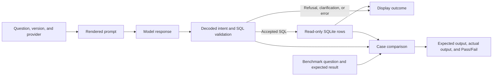

# System architecture

## Prompt engineering workflow

## Input and output flow

The browser accepts a question, database, provider, and strategy. The pipeline loads the selected schema and renders the prompt. V1 uses only the question. V2 and V3 add schema context, and V3 embeds worked examples. A valid SQL response produces column labels and rows in the playground. The evaluator also loads a reference query and expected behavior for each benchmark case, compares results where applicable, and exports a trace and aggregate metrics.
